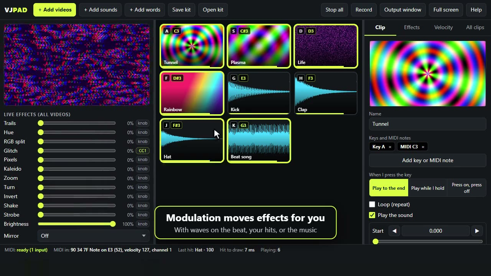

# VJ Pad

A live video performance program for a high school English learner class. Students assign video clips and sounds to computer keys or MIDI notes, then play them like instruments.

There are two versions:

- **Computer version:** one file, `VJ Pad.html`. There is nothing to install, and it runs without internet. It has MIDI and the Output window.
- **iPad version:** the `iPad website` folder, published at **https://williamopenshaw.github.io/vj-pad/**. See [iPads](#ipads-and-students-who-cannot-open-the-file).

Both versions open the same `.vjkit` files.

**[Watch the 1-minute demo](docs/demo.mp4)** (with sound). It was recorded automatically by `node tools/demo/record-demo.js`.

## Getting started

1. Copy `VJ Pad.html` to the student's computer (email, shared drive or USB).
2. Open it in **Chrome or Edge**. Safari does not support MIDI, so Mac students should use Chrome or Edge too.
3. Click **Start**. If you use a MIDI controller, connect it first and click **Allow** when the browser asks.
4. Click **+ Add videos** or **+ Add sounds**, or drag files onto the window.
5. Press the key shown on a pad to play it.

The **Help** button in the program has student instructions in simple English.

## iPads, and students who cannot open the file

On an iPad, tapping an HTML file in the Files app only shows a preview with the program turned off, so VJ Pad cannot run that way. Some school computers also open HTML files in a preview or a text editor instead of a browser.

The fix is the iPad version on a website. Students open a link. On iPad, they can tap **Share**, then **Add to Home Screen**. VJ Pad then opens like an app, full screen, and works without internet after the first visit. The link also works on a computer that cannot open the file, but without MIDI.

### The iPad link

**https://williamopenshaw.github.io/vj-pad/**

On the iPad, students:

1. Open the link in **Safari**.
2. Tap **Share**, then **Add to Home Screen**, then **Add**.
3. Open **VJ Pad** from the new icon, and tap **Start**.

This GitHub repository publishes the `iPad website` folder with GitHub Pages. Every change pushed to the `main` branch updates the site within about a minute (see the **Actions** tab). Students get the new version the next time they open VJ Pad with internet.

The folder holds `index.html` (the program), `manifest.webmanifest` and `sw.js` (Home Screen app and offline use), and three icons. It also works on any other host that serves plain files over HTTPS. Google Sites, Google Drive and Apps Script cannot run it.

### What is different on iPad

- **MIDI controllers do not work.** Safari, and every other iPad browser, has no MIDI support. Students tap the pads instead, with several fingers at once, or use a keyboard case.
- **Tapping:** tap high on a pad for a hard hit, low for a soft hit.
- **No Output window.** Use Screen Mirroring or a cable to show the iPad on a projector.
- **Fewer clips at full speed:** iPads have less memory, so after 12 clips each clip gets one player instead of two, and a kit holds about 32 players.
- **Save kits often.** Safari can delete website data that has not been used for 7 days, unless VJ Pad was added to the Home Screen.
- **Videos from Photos** (HEVC `.mov`) play on iPad.
- **No knob or MIDI clock settings**, because there is no MIDI. Modulation still works with **Tap** tempo.

## Best files

### Videos

- MP4 (H.264), 720p or smaller, and short: 2 to 20 seconds.
- iPhone `.mov` files may not play on some computers. If a pad says "Cannot play this video", convert the clip to MP4 (H.264).
- A kit can hold about 30 video clips at full speed. Above that, new clips get one player instead of two, so very fast repeated hits are less smooth. The limit is about 70 players. Sounds do not count.

### Sounds

- MP3, WAV, M4A/AAC, OGG and FLAC, up to 10 minutes each.
- **Short sounds** (a drum, a word, a sound effect) play the moment you hit them, many times a second. Soft hits are quieter.
- **Songs:** a sound longer than 20 seconds starts as **Press on, press off**, so one press starts the song and the next press stops it. Use **Sound** in the **Effects** tab to make it quieter than the hits.
- Sound pads show a picture of the sound wave. They put nothing on the screen.
- A sound changes pitch when its speed changes, like a record. With **Follow the MIDI note**, one short sound plays as a melody across the MIDI keyboard.

## Main features

| Feature | Where to find it |
|---|---|
| Assign keys and MIDI notes | **Clip** tab: **Add key or MIDI note** |
| Play to the end, hold, or press on/press off; loop | **Clip** tab |
| Set start and end: type, ◀ ▶ one frame, scroll, or drag (Shift = 10 frames) | **Clip** tab |
| Even loudness, peak to 0 dB, or off | **Clip** tab or **All clips** tab |
| Pitch changes with speed (default), or keep the same pitch | **Clip**, **Effects**, **Velocity** or **All clips** tab |
| Make a clip follow the MIDI note | **Clip** tab: **Follow the MIDI note** |
| Velocity control of speed, brightness, effects and more | **Velocity** tab (one clip) or **All clips** tab (shared) |
| Clip effects, blend modes and fades | **Effects** tab |
| Live effects, with optional MIDI knobs | Left panel |
| Modulation: effects that move with a wave, the tempo, your hits or the sound | Left panel, under Live effects |
| Words on screen | **+ Add words**, or the **Clip** tab for any video |
| Projector window (double-click it for full screen) | **Output window** button |
| Record the show to a video file | **Record** button |

Drag the boundaries beside the pads to resize the panels. Double-click a boundary to reset it.

### Modulation

Modulation moves live effects for you, so the show changes even when you are not touching anything. Each row says *source → effect* and an **Amount** (a minus amount moves the effect the other way).

- **Wave A**, **Wave B:** smooth waves, ramps, on and off, pulses or random steps, from 1 to 16 beats long.
- **Sound level**, **Low sound (bass)**, **High sound:** follow what VJ Pad is playing, for example a song added with **+ Add sounds**.
- **Hits:** jumps up on each hit, harder hits jump higher, then it falls.
- **Tempo:** type it, or click **Tap** on the beat 4 times. On a computer, **Follow MIDI clock** takes the tempo from a keyboard or music program that sends clock.
- For safety, modulation cannot move **Brightness**, **Invert** or **Strobe**, and a wave changes at most 3 times a second.

### Useful keys

- **Space** stops all videos and sounds.
- **Shift** + key is a hard hit on a computer keyboard.
- **Esc** leaves full screen.
- Click high on a pad for a hard hit, or low for a soft hit.

## Saving work

The program remembers the current kit in that browser on that computer. This is not a safe long-term copy, especially on shared computers, and there is only one kit per browser.

**Save kit** puts the videos and settings into one `.vjkit` file in Downloads. Use **Open kit** to load it on another computer. Opening a kit replaces the current one.

## Known limits

- **Tested MIDI controller:** Novation Launchkey Mini MK4 25 in Chrome on Windows.
- **Not tested yet:** a real iPad (tested only in WebKit, the engine iPad browsers use, on Windows, where sound clips cannot be tested), real MP3 files (tested with WAV and M4A), Mac computers, a real projector or second screen, and MIDI clock from a real keyboard.
- **MIDI not working?** Look at the **MIDI monitor** at the bottom of the left panel, and **MIDI in** in the bottom bar. They show whether the browser allowed MIDI, which devices are listening, and every message received. Chrome asks to "control and reprogram MIDI devices"; click **Allow**. Close other browsers and music programs, because Windows lets only one program use a MIDI device at a time. Then click **Connect MIDI**.
- **Chords and fixed pitch:** one clip plays one pitch at a time, and the program cannot detect what note a clip is in. Computer keys ignore **Follow the MIDI note**. For a chord, use one copy of the clip per note.
- **Very large videos:** files over 400 MB are not measured for loudness and play at their own volume.
- **Quiet clips:** sound can be raised by at most 24 dB.
- **Latency:** hits draw in about 2 to 14 ms in testing on one Windows computer. This does not include the monitor's delay. Large files or slower computers will be slower.

## Changing the program

The two versions are made from one file, `source/VJ Pad.source.html`. After changing it, run `node source/build.mjs` (needs [Node.js](https://nodejs.org)) to make `VJ Pad.html` and `iPad website/index.html` again. Do not edit those two files directly. If a pushed change was not rebuilt, the GitHub Pages workflow stops and the website keeps the old version.

## Safety

Fast flashing can make some people sick. Strobe is limited to 3 flashes per second, but please ask the class before using it.

## License

MIT. See [LICENSE](LICENSE). Anyone may use, copy, change and share VJ Pad, also for other classes and schools, as long as the license notice stays with it.
